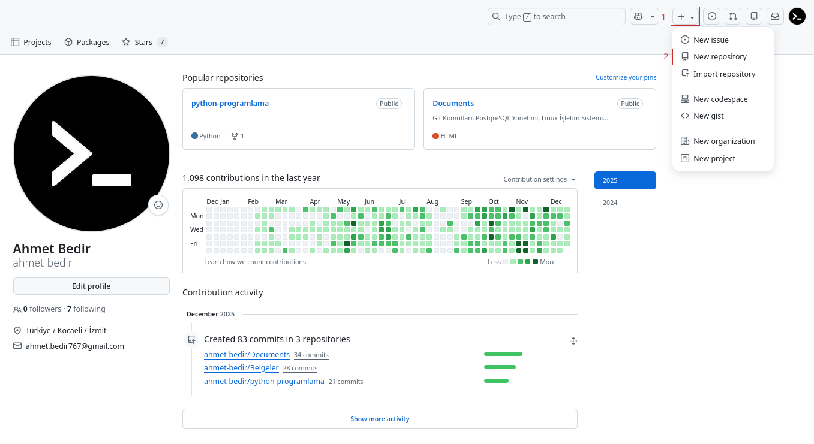
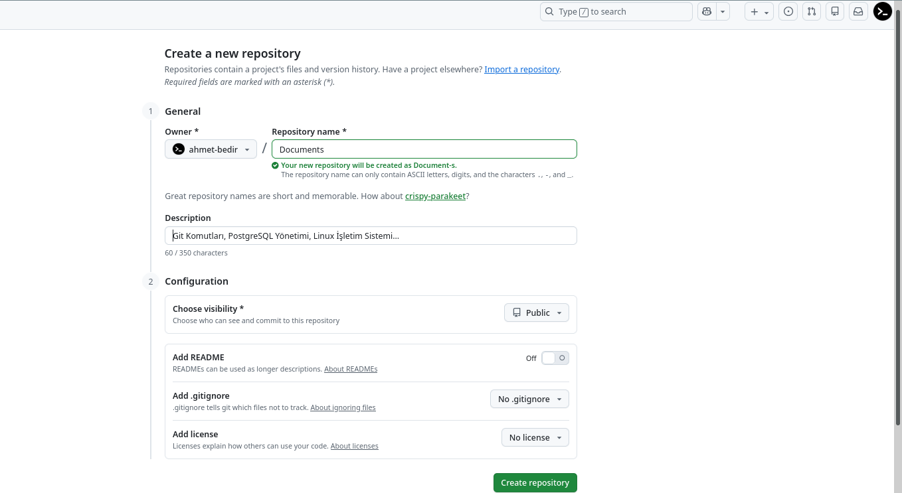

<p align="center">
	
<p/>


# Git (Global Information Tracker – Küresel Bilgi İzleyici)


###### Son güncelleme : 09/2026

---

<a id="basa-don"></a>

**İçindekiler**

▪ [**Git Nedir?**](#git)<br/>▪ [**Git Kurulum ve Yapılandırma**](#git-config)<br/>▪ [**Repository Oluşturma**](#git-repo)<br/>

---

## VCS (Version Control System – Versiyon Kontrol Sistemi)

Bir proje geliştirirken yaptığın her değişikliğin ne zaman, kim tarafından, neden yapıldığını kaydetmek ve istediğin ana geri dönmek için kullanılır. Dosyalardaki değişikliklerin geçmişini takip eden ve geri dönüş imkânı veren bir sistemdir.

### 📅 VCS'nin Tarihi

#### 🏛️ 1. Nesil: Yerel Sistemler (1970-80'ler)

İlk VCS'ler tek bir bilgisayarda çalışıyordu.

**RCS (Revision Control System, 1982):** Dosyaların değişiklik geçmişini yerel olarak saklıyordu. Tek bir kullanıcı, tek bir bilgisayar.

```text
┌───────────────────────────────┐
│         Bilgisayarım          │
│                               │
│  dosya.c  ←→  RCS veritabanı  │
│               (değişiklikler) │
└───────────────────────────────┘
```

> **Sorun:** Ekip çalışması yok. Herkes kendi makinesinde. Dosyaları paylaşmak için USB bellek veya e-posta gerekiyor.

#### 🏢 2. Nesil: Merkezi Sistemler (1990-2000'ler)

CVS (1990) ve Subversion/SVN (2000) ile merkezi model.

Tek bir sunucu ile herkes bu sunucuya bağlanıyor. Değişiklikleri sunucuya gönderiyor, sunucudan alıyor.

```text
                ┌──────────────┐
                │   SUNUCU     │
                │  (Merkezi    │
                │    Depo)     │
                └──────┬───────┘
                       │
            ┌──────────┼──────────┐
            │          │          │
       ┌────┴────┐ ┌───┴────┐  ┌──┴──────┐
       │ Ali'nin │ │Ayşe'nin│  │Mehmet'in│
       │   PC    │ │   PC   │  │   PC    │
       └─────────┘ └────────┘  └─────────┘

       Her PC'de sadece dosyaların SON HALİ var.
       Geçmiş? Sadece sunucuda.
```

> **İyileştirme:** Artık ekip çalışması mümkün. Ali ve Ayşe aynı projede çalışabiliyor.

**Merkezi (Centralized) Model Dezavantajları:**

- **Tek nokta arızası (Single Point of Failure):** Sunucu çökerse? Kimse çalışamaz. Geçmiş kaybolabilir.
- **Ağ bağımlılığı:** İnternetsiz commit bile yapamazsın.
- **Yavaşlık:** Her işlem sunucuyla iletişim gerektirdiği için log bakmak bile ağ hızına bağlıydı.
- **Branching:** SVN'de branch açmak çok yavaş ve karmaşıktı.

#### 🌐 3. Nesil: Dağıtık Sistemler (2005-Günümüz)

**Dağıtık (Distributed) Model — Git ve Türevleri**

- Her geliştirici, projenin tam kopyasına sahip.
- İnternetsiz çalışabilirsin.
- Sunucu çökerse? Herkesin yedeği var. Diğer bilgisayardan geri yükleme yapılabilir.

---

### Merkezi vs Dağıtık: Temel Fark

**Merkezi (Centralized) Model — SVN Tarzı**

```text
                    ┌──────────────────┐
                    │    SUNUCU (SVN)  │
                    │                  │
                    │  Tüm geçmiş      │
                    │  Tüm branch'ler  │
                    │  Tüm commit'ler  │
                    └────────┬─────────┘
                             │
              ┌──────────────┼──────────────┐
              │              │              │
         ┌────┴────┐    ┌────┴────┐    ┌────┴────┐
         │   Ali   │    │  Ayşe   │    │  Mehmet │
         │         │    │         │    │         │
         │ Sadece  │    │ Sadece  │    │ Sadece  │
         │ son hal │    │ son hal │    │ son hal │
         └─────────┘    └─────────┘    └─────────┘
```

> - Sunucu = tek gerçek kaynak (single source of truth)
> - Geliştiricilerde sadece dosyaların son hali var
> - Geçmişe bakmak, branch açmak için → sunucuya bağlanma gerek
> - Sunucu çökerse tüm geçmiş kaybolabilir

**Dağıtık (Distributed) Model — Git Tarzı**

```text
    ┌──────────────┐    ┌──────────────┐    ┌──────────────┐
    │     Ali      │    │    Ayşe      │    │    Mehmet    │
    │              │    │              │    │              │
    │  TÜM geçmiş  │    │  TÜM geçmiş  │    │  TÜM geçmiş  │
    │  TÜM branch  │    │  TÜM branch  │    │  TÜM branch  │
    │  TÜM commit  │    │  TÜM commit  │    │  TÜM commit  │
    └──────┬───────┘    └──────┬───────┘    └──────┬───────┘
           │                   │                   │
           └───────────────────┼───────────────────┘
                               │
                    ┌──────────┴──────────┐
                    │   GitHub / GitLab   │
                    │   (Uzak Depo —      │
                    │    isteğe bağlı)    │
                    └─────────────────────┘
```

> - Her geliştirici, projenin **tam kopyasına** sahip
> - İnternetsiz çalışabilirsin: commit at, branch aç, geçmişe bak
> - GitHub/GitLab var ama "merkez" değil — sadece kolaylık sağlayan bir paylaşım noktası
> - Sunucu çökerse? Yedekten geri alınabilir

**Fark Tablosu**

| Özellik         | Merkezi (SVN)     | Dağıtık (Git)             |
| :-------------- | :---------------- | :------------------------ |
| Offline çalışma | ❌ Hayır           | ✅ Tam destek              |
| Hız             | 🐌 Ağa bağlı       | ⚡ Yerel, çok hızlı        |
| Yedekleme       | 😰 Tek nokta       | 😎 Her kopya bir yedek     |
| Branch açma     | 🐌 Yavaş, zahmetli | ⚡ Saniyenin altında       |
| Geçmişe bakma   | 🐌 Sunucuya bağlan | ⚡ Hep yerel               |
| Öğrenme eğrisi  | 📉 Daha basit      | 📈 Daha dik ama daha güçlü |

---

<a id="git"></a>

## Git Nedir?

[**⬆ Başa Dön**](#basa-don)

Git, yazılım geliştirme süreçlerinde kod değişikliklerini zaman içinde kaydetmek ve takip etmek için kullanılan **dağıtık bir versiyon kontrol sistemidir**. Aynı proje üzerinde çalışan birden fazla yazılımcının kodları birbirine karıştırmadan, eş zamanlı ve düzenli bir şekilde geliştirmesini sağlar. Hatalı güncellemelerde projenin eski sürümlerine kolayca geri dönülmesine imkan tanıyarak **veri kaybını önler**. Git, her commit'te projenin tamamının **anlık görüntüsünü (snapshot)** saklar.

> Git **snapshot** (anlık görüntü) tabanlıdır, diff (fark) tabanlı değil — bu onu hızlı ve güvenilir yapar. Her görüntü = bir **commit**. Her commit, projenin o andaki tam fotoğrafı. Ve git bu fotoğrafları verimli bir şekilde saklıyor — her seferinde tüm dosyaları kopyalamak yerine, sadece **değişenleri** kaydediyor.

### Git Kullanım Senaryoları

#### 1. Zaman Yolculuğu

```bash
# 3 ay önceki projenin haline bak
$ git log --oneline
# a1b2c3d Login sayfası eklendi
# d4e5f6g Veritabanı bağlantısı
# h7i8j9k Proje başlatıldı

$ git checkout h7i8j9k    # Projeyi ilk haline geri götür
$ git checkout main         # Tekrar bugüne dön
```

#### 2. Paralel Geliştirme

```bash
# Ana projeden bağımsız, yeni özellik geliştir
$ git branch yeni-ozellik         # Yeni branch aç
$ git checkout yeni-ozellik     # Yeni branch'e geç

# ... Kodla, test et, dene ...
# Hazır olunca ana projeye birleştir
$ git checkout main            # Önce ana branch'e geç
$ git merge yeni-ozellik     # Sonra yeni branch'i birleştir
```

#### 3. Ekip Çalışması

```bash
# Arkadaşının değişikliklerini al
$ git pull origin main

# Kendi değişikliklerini gönder
$ git push origin main
```

#### 4. Güvenli Deneme

```bash
# Radikal bir değişiklik denemek istiyorsun
# Yeni branch aç
$ git branch deney

$ git checkout deney      # Yeni branch'e geç
# ... Yeni değişiklikler yap ...

# Olmadı mı? Sil
$ git checkout main       # Önce ana branch'e geç
$ git branch -D deney   # Sonra yeni branch'i sil
# Ana proje tertemiz, hiç dokunulmamış
```

#### 5. Bug Avı

```bash
# Hangi commit ile bug girmiş? Git bulsun:
$ git bisect start
$ git bisect bad                # Şu an bozuk
$ git bisect good v1.0    # v1.0'da çalışıyordu
# Git, binary search ile sorumlu commit'i bulur
```

---

### Git Ekosistemi

```text
                         ┌───────────────────┐
                         │      Git CLI      │
                         │  (Komut Satırı)   │
                         └────────┬──────────┘
                                  │
                 ┌────────────────┼────────────────┐
                 │                │                │
          ┌──────┴──────┐   ┌─────┴──────┐  ┌──────┴──────┐
          │   GUI'ler   │   │  Hosting   │  │   CI/CD     │
          │             │   │            │  │             │
          │ VS Code Git │   │ GitHub     │  │ GitHub      │
          │ GitKraken   │   │ GitLab     │  │ Actions     │
          │ Sourcetree  │   │ Bitbucket  │  │ Jenkins     │
          │ Fork        │   │ Gitea      │  │ GitLab CI   │
          └─────────────┘   └────────────┘  └─────────────┘
```

> - **GUI Araçları:** Komut satırına alternatif olarak grafik arayüzler var.
> - **Hosting:** Kodunu bulutta tutmak, paylaşmak, işbirliği yapmak için.
> - **CI/CD:** Kodun her push'ta otomatik test edilmesi, derlenmesi, deploy edilmesi.

---

### Üç Alan (Three States): Working Directory, Staging Area, Repository

Git, dosyalarını üç temel alanda yönetir.

```text
┌──────────────┐     ┌──────────────┐      ┌──────────────┐
│   Working    │     │   Staging    │      │  Repository  │
│  Directory   │────▶│    Area      │─────▶│   (.git)     │
│              │ add │   (Index)    │commit│              │
│ Dosyalarını  │     │   Sahneye    │      │    Kalıcı    │
│ düzenlediğin │     │ hazırladığın │      │    kayıt     │
│     yer      │     │     yer      │      │              │
└──────────────┘     └──────────────┘      └──────────────┘
```

#### 1. Working Directory (Çalışma Dizini)

Dosyalarını düzenlediğin, kodlarını yazdığın yer. Git'in gözünde bu alan "kontrol dışı" — yani burada ne yaparsan yap, henüz kayıt altına alınmadı.

```text
Working Directory'deki dosya durumları:

┌──────────────┐
│  Untracked   │  Git bu dosyayı hiç bilmiyor (yeni eklendi)
├──────────────┤
│  Modified    │  Git tanıyor ama son commit'ten beri değişmiş
├──────────────┤
│  Unmodified  │  Git tanıyor ve değişmemiş (commit'teki haliyle aynı)
└──────────────┘
```

**Dosya Durumları:**

> - Untracked (İzlenmeyen): Git bu dosyayı hiç bilmiyor. Yeni oluşturulmuş, hiç `git add` edilmemiş.

```bash
$ touch yeni_dosya.txt
$ git status
Untracked files:
        yeni_dosya.txt
```

> - Staged (Hazırlanmış): `git add` ile staging area'ya alınmış. Bir sonraki commit'e dahil edilecek.

```bash
$ git add yeni_dosya.txt
$ git status
Changes to be committed:
        new file:   yeni_dosya.txt
```

> - Unmodified (Değişmemiş): Commit'lenmiş ve o zamandan beri dokunulmamış.

```bash
$ git commit -m "Yeni dosya eklendi"
$ git status
nothing to commit, working tree clean
# Tüm dosyalar "unmodified" durumunda
```

> - Modified (Değişmiş): Commit'lenmiş ama sonra tekrar  düzenlenmiş. Git farkı biliyor ama henüz staging'e alınmamış.

```bash
$ echo "yeni satır" >> yeni_dosya.txt
$ git status
Changes not staged for commit:
        modified:   yeni_dosya.txt
```

#### 2. Staging Area (Hazırlık Alanı / Index)

Staging area, "bir sonraki commit'e neleri dahil edeceğim?" sorusunun cevabı.

```text
git add dosya.txt      # dosya.txt'yi sepete koy (staging'e al)
git commit             # sepetteki her şeyi satın al (commit'le)
```

**Neden böyle bir ara katman var?**

Her değişikliği aynı commit'e koymamak için. Diyelim ki bir dosyada hem bug fix yaptın hem yeni özellik ekledin. Bunları ayrı commit'lemek için:

```bash
# Bug fix'i staging'e al
$ git add login.js

# Commit 1: Sadece bug fix
$ git commit -m "fix: Login hata mesajı düzeltildi"

# Yeni özelliği staging'e al
$ git add dashboard.js

# Commit 2: Sadece yeni özellik
$ git commit -m "feat: Dashboard widget eklendi"
```

> Bu sayede commit geçmişin temiz, anlaşılır ve geri alınabilir olur.

#### 3. Repository (`.git` dizini)

Repository (kısaca repo), git tarafından izlenen bir proje klasörüdür. Normal bir klasörden farkı, içinde `.git` adlı gizli bir dizin barındırmasıdır.

`.git` dizini = Tüm commit geçmişi, branch'ler, ayarlar bu dizinde saklanır. Bu dizini silersen, git geçmişi kaybolur (dosyalar kalır ama geçmiş gider).

İki tür repository vardır:

```text
┌──────────────────────────┐    ┌──────────────────────────┐
│    Yerel Repo (Local)    │    │    Uzak Repo (Remote)    │
│                          │    │                          │
│  Senin bilgisayarında    │    │  GitHub, GitLab, vb.     │
│  git init ile oluşturur  │    │  İnternette barınır      │
│  veya git clone ile      │    │  Ekip paylaşımı için     │
│  kopyalarsın             │    │                          │
│                          │◄──►│                          │
│  Commit, branch,         │    │  push/pull/fetch ile     │
│  her şeyi yaparsın       │    │  senkronize olur         │
└──────────────────────────┘    └──────────────────────────┘
```

> Commit'lediğin her şey burada **kalıcı olarak** saklanır. Her commit bir snapshot gibi ve bu snapshot'lar zincir gibi birbirine bağlı.

### Üç Alanın Akışı

```text
  Working Directory          Staging Area            Repository
   (Çalışma Alanı)            (Hazırlık)              (.git)
  ─────────────────         ──────────────          ──────────────
                    
  dosya.txt [değişti]
          │
          │  git add dosya.txt
          ▼
                            dosya.txt [hazır]
                                    │
                                    │  git commit -m "mesaj"
                                    ▼
                                                    Commit #abc123
                                                    dosya.txt kaydedildi


  ◄─────────────────────────────────────────────────────────
                    git checkout / git restore
                    (Commit'teki hali geri getirir)
```

Bu akışın CLI komutları:

```bash
# 1. Dosya oluştur (Working Directory'de)
$ echo "Merhaba Git" > merhaba.txt

# 2. Git'in durumuna bak
$ git status
On branch main
Untracked files:
  (use "git add <file>..." to include in what will be committed)
        merhaba.txt

# "Untracked" = Git bu dosyayı tanımıyor, izlemiyor

# 3. Staging'e al
$ git add merhaba.txt

$ git status
On branch main
Changes to be committed:
  (use "git restore --staged <file>..." to unstage)
        new file:   merhaba.txt

# "Changes to be committed" = Staging'de, commit'e hazır

# 4. Commit'le
$ git commit -m "İlk dosya eklendi..."
[main abc1234] İlk dosya eklendi
 1 file changed, 1 insertion(+)
 create mode 100644 merhaba.txt

$ git status
On branch main
nothing to commit, working tree clean

# "Clean" = Her şey commit'lenmiş, değişiklik yok
```

---

<a id="git-config"></a>

## Git Kurulumu

[**⬆ Başa Dön**](#basa-don)

### Windows'ta Git Kurulumu

Windows'ta Git'i kurmanın en yaygın yolu **Git for Windows** paketini kullanmaktır.

**Adım 1:** https://git-scm.com adresine git ve "Download for Windows" butonuna tıkla.

**Adım 2:** İndirilen `.exe` dosyasını çalıştır.

**Adım 3:** Kurulum sihirbazında önemli seçenekler:

```text
Kurulum Ekranları — Önerilen Seçimler:

1. Components: ✅ Git Bash Here (sağ tık menüsüne ekler)
               ✅ Git GUI Here
               ✅ Git LFS

2. Default Editor: "Use Visual Studio Code as Git's default editor"
   (Varsayılan editör seçimi)

3. Default Branch: "Override the default branch name: main"
   (Eski varsayılan branch "master" yerine "main" kullan)

4. PATH: "Git from the command line and also from 3rd-party software"
   (Git'i her yerden kullanabilmek için)

5. SSH: "Use bundled OpenSSH"

6. Line Endings: "Checkout Windows-style, commit Unix-style"
   (Satır sonu windows'ta CRLF, commit'te LF — en güvenli seçenek)
```

**Adım 4:** Kurulumu tamamla ve terminali aç:

```bash
# Git Bash'i aç (veya PowerShell/CMD)
$ git --version
git version 2.43.0.windows.1
```

> ⚠️ **Dikkat:** Windows'ta **Git Bash** kullanmanı öneriyorum. Bash, Linux/Mac komutlarıyla çalışır ve internet üzerindeki Git kaynaklarının çoğu Bash komutları gösterir. PowerShell veya CMD de çalışır ama bazı komutlar farklı olabilir.

### macOS'ta Git Kurulumu

Mac'te Git'in zaten kurulu olma ihtimali yüksek. Kontrol edelim:

```bash
$ git --version
git version 2.39.3 (Apple Git-145)
```

> Eğer kurulu değilse, macOS sana **Xcode Command Line Tools** yüklemeyi önerecektir. Kabul et.

**Alternatif: Homebrew ile kurulum (önerilen)**

> **Homebrew, macOS'un paket yöneticisidir**. Git'in en güncel versiyonunu almak için:

```bash
# Homebrew yoksa önce onu kur
$ /bin/bash -c "$(curl -fsSL https://raw.githubusercontent.com/Homebrew/install/HEAD/install.sh)"

# Git'i kur
$ brew install git

# Versiyonu kontrol et
$ git --version
git version 2.43.0
```

> 💡 **İpucu:** Apple'ın kendi Git versiyonu genelde biraz geride kalır. Homebrew ile kurduğunda her zaman en güncel versiyonu alırsın. `brew upgrade git` komutu ile güncelleme yapılır.

### Linux'ta Git Kurulumu

Dağıtıma göre farklı komutlarla git kurulumu:

```bash
# Ubuntu / Debian
$ sudo apt update
$ sudo apt install git

# Fedora
$ sudo dnf install git

# Arch Linux
$ sudo pacman -S git

# CentOS / RHEL
$ sudo yum install git

# Kurulumu doğrula
$ git --version
git version 2.43.0
```

En güncel versiyon için ubuntu veya debian tabanlı linux dağıtımlarına git sürüm kontrol sisteminin resmi bakımcıları (git core ekibi) tarafından yönetilen PPA (Personal Package Archive / Kişisel Paket Arşivi) deposunu ekle:

```bash
$ sudo add-apt-repository ppa:git-core/ppa
$ sudo apt update
$ sudo apt install git
$ git --version
git version 2.43.0
```

------

## Git Yapılandırma | `git config`

[**⬆ Başa Dön**](#basa-don)

### Yapılandırma Seviyeleri

Git'in üç farklı yapılandırma seviyesi vardır:

```text 
┌──────────────────────────────────────────────────────┐
│  System  (/etc/gitconfig)                            │
│  Tüm kullanıcılar, tüm repolar için geçerli          │
│                                                      │
│  ┌──────────────────────────────────────────────┐    │
│  │  Global  (~/.gitconfig)                      │    │
│  │  Bu kullanıcının tüm repoları için geçerli   │    │
│  │                                              │    │
│  │  ┌──────────────────────────────────────┐    │    │
│  │  │  Local  (.git/config)                │    │    │
│  │  │  Sadece bu repo için geçerli         │    │    │
│  │  │  ⬆️ EN YÜKSEK ÖNCELİK                │    │    │
│  │  └──────────────────────────────────────┘    │    │
│  └──────────────────────────────────────────────┘    │
└──────────────────────────────────────────────────────┘
```

> - **System:** Bilgisayardaki tüm kullanıcılar için. Nadiren dokunursun.
> - **Global:** Senin kullanıcı hesabın için. En çok bunu kullanacağız.
> - **Local:** Sadece o repo için. Farklı projeler için farklı ayar gerektiğinde.

---

**Git'in sistemine kullanıcıadımızı ve e-mail adresimizi tanımlamak için:**

```bash
git config --global user.name "user_name"
git config --global user.email "user_email"
```

> Depoya özgü yani local kullanıcıadı ve email tanımlama işlemi için `--global` anahtarının belirtilmemesi veya `--global` anahtarı yerine `--local` anahtarı yazılması gerekir. Local ayar, global'den önceliklidir. O repoda yaptığın commit'ler `--local` anahtarı ile tanımladığın kullanıcı bilgileri ile kayıt olur.
>
> ⚠️ Dikkat: Bu bilgiler önemli? Çünkü her commit'te gözükür. Bu ayarları yapmazsan, commit atarken seni uyarır veya sistemin hostname ve kullanıcı adını kullanır. (user.name "root" ve user.email "root@localhost" olarak gözükür.)

**Farklı proje için farklı kimlik:**

Diyelim ki kişisel projelerinde `user@gmail.com` ama iş projelerinde `user@sirket.com` kullanmak istiyorsun:

```bash
# Global ayar (varsayılan)
$ git config --global user.email "user@gmail.com"

# Sadece iş projesinde (o repoda)
$ cd ~/work/sirket-projesi
$ git config --local user.email "user@sirket.com"
```

> Local ayar, global'den önceliklidir. O repoda yaptığın commit'ler iş e-postanla kayıt olur.

**Tanımlamış olduğumuz kullanıcı adını veya email adresini görüntülemek için:**

```bash
git config --global user.name
git config --global user.email

# Tüm ayarlar için
git config --global --list
```

> Not: Depoya özgü yani local konfigurasyonlar için `git config user.name` veya `git config user.email` komutları, tüm ayarlar için `git config --local --list` komutu kullanılır.

---

### Varsayılan Editör

> - VS Code ayarlamak için:
>  
>    `git config --global core.editor "code --wait"`

> - Nano ayarlamak için:
>
>    `git config --global core.editor "nano -w"`

> - Vim ayarlamak için:
>
>    `git config --global core.editor "vim"`

> - Gedit (linux) ayarlamak için:
>
>    `git config --global core.editor "gedit --wait --new-window"`

> - Emacs ayarlamak için:
>
>    `git config --global core.editor emacs`

> - Sublime Text  ayarlamak için:
>
>    `git config --global core.editor "subl -n -w"`

**Git varsayılan editörü görüntülemek için:**

```bash
git config --global core.editor
```

> 💡 İpucu: Git, editörü açar ve senin düzenleme yapıp kaydetmeni bekler. `--wait` bayrağı olmadan git hemen devam eder ve boş mesaj alır.

---

### Varsayılan Branch İsmi

Varsayılan brach ismini değiştirmek için:

```bash
git config --global init.defaultBranch main
```

> 💡 İpucu: Bu ayardan sonra `git init` ile oluşturulan tüm yeni repolar `main` branch'i ile başlar.

### Satır Sonu Ayarları (Line Endings)

Windows `CRLF` (\r\n), Linux/Mac `LF` (\n) kullanır. Ekipte karışık işletim sistemi varsa sorun olur.

```bash
# Windows'ta:
$ git config --global core.autocrlf true
# Checkout: LF → CRLF, Commit: CRLF → LF

# Mac/Linux'ta:
$ git config --global core.autocrlf input
# Checkout: dokunma, Commit: CRLF → LF (yanlışlıkla CRLF girdiyse düzelt)
```

### Renklendirme

Git çıktılarını renkli görmek okunaklığı artırır:

```bash
$ git config --global color.ui auto
```

> Bu ayar genelde varsayılan olarak açıktır.

### Tüm Ayarları Görüntüleme

```bash
# Tüm aktif ayarlar (global+local)
$ git config --list
user.name=termux
user.email=community@termux.com
core.editor=code --wait
init.defaultbranch=main
core.autocrlf=true
color.ui=auto

# Belirli bir ayar
$ git config user.name
termux

# Ayarın hangi dosyadan geldiğini görme
$ git config --show-origin user.name
file:/home/user/.gitconfig  termux
```

### Ayar Silme

```bash
# Bir ayarı sil
$ git config --global --unset user.name

# Bir bölümü tamamen sil
$ git config --global --remove-section user
```

### Alias (Kısayollar)

Alias'lar, sık kullandığın komutlara kısayol tanımlar. Kısayol tanımlama şekli:

```bash
$ git config --global alias.<kısayol> <komut_adı>
```

Örnekler:

```bash
# Kısa log görünümü
$ git config --global alias.lg "log --oneline --graph --all --decorate"

# Durum kısayolu
$ git config --global alias.st "status"

# Kısa commit
$ git config --global alias.cm "commit -m"

# Branch listesi
$ git config --global alias.br "branch"

# Checkout kısayolu
$ git config --global alias.co "checkout"

# Son commit'i göster
$ git config --global alias.last "log -1 HEAD"

# Unstage (staging'den çıkar)
$ git config --global alias.unstage "restore --staged"
```

Kullanımı:

```bash
# Artık komutu uzun yazmak yerine:
$ git log --oneline --graph --all --decorate

# Kısa yazabilirsin:
$ git lg
* a1b2c3d (HEAD -> main) Feature X eklendi
* d4e5f6g Login sayfası
* h7i8j9k İlk commit
```

### SSH Key Oluşturma ve Yapılandırma

#### SSH Neden Gerekli?

GitHub, GitLab gibi platformlara kodu göndermek (push) için kimliğini doğrulamalısın. İki yol var:

1. **HTTPS:** Her seferinde kullanıcı adı/şifre veya token girersin.

2. **SSH:** Bir kere anahtar çifti oluşturursun, sonra şifresiz bağlanırsın.

#### SSH Nasıl Çalışır?

```text
┌──────────────────────────────────────────────────────┐
│                   SSH Key Çifti                      │
│                                                      │
│  🔑 Private Key (Özel Anahtar)                       │
│  ~/.ssh/id_ed25519                                   │
│  ❌ KİMSEYLE PAYLAŞMA! Bilgisayarında kalır.         │
│                                                      │
│  🔓 Public Key (Genel Anahtar)                       │
│  ~/.ssh/id_ed25519.pub                               │
│  ✅ GitHub'a, GitLab'a ekle. Paylaşılabilir.         │
│                                                      │
│  Not: Kapının kilidi (public) herkeste olabilir      │
│  ama anahtarı (private) sadece sende.                │
└──────────────────────────────────────────────────────┘
```

> - **Public key** = açık asma kilit — GitHub'a veriyorsun, "benim mesajlarımı bununla kilitle" diyorsun
> - **Private key** = sadece senin anahtarın

#### Komut Satırında SSH ile Kimlik Doğrulama

1.SSH anahtarınızı oluşturmak için:

```bash
ssh-keygen -t ed25519 -C "email@adresiniz.com"
```

> Not: Ssh key anahtarı `ed25519` algoritması ile modern, güvenli, hızlı.

Terminalde size bazı sorular sorar:

```text
Generating public/private ed25519 key pair.
Enter file in which to save the key (/home/kullanıcı/.ssh/id_ed25519): 
# Varsayılan konum için enter'a bas veya yeni bir konum gir

Enter passphrase (empty for no passphrase): 
# Güçlü bir parola gir (önerilir) veya boş bırak

Enter same passphrase again:
# Aynı parolayı tekrar gir

Your identification has been saved in /home/kullanıcı/.ssh/id_ed25519
Your public key has been saved in /home/kullanıcı/.ssh/id_ed25519.pub
The key fingerprint is:
SHA256:xxxxxxxxxxxxxxxxxxxxxxxxxxxxxxxxxxxxxxxxxxx email@adresiniz.com
The key's randomart image is:
+--[ED25519 256]--+
|        .oo.     |
|       . o.o     |
|        = +.o    |
|       . B.=     |
|      . S.=.o    |
|     . + o.+.    |
|      + o.+.     |
|     . +.o.+     |
|      o.oo=.     |
+----[SHA256]-----+
```

2.Genel anahtarı kopyalamak için:

```bash
$ cat ~/.ssh/id_ed25519.pub
ssh-ed25519 AAAAC3NzaC1lZDI1NTE5AAAAIG... email@adresiniz.com

# çıktının tamamını kopyala
```

3.Genel anahtarı GitHub’a ekleyin:

> - GitHub’da sağ üstte profil fotoğrafınıza tıklayın → Settings → SSH and GPG keys → New SSH key
> - Title: "Kişisel Laptop" kTitle kısmına bir isim verin)
> - Key type: "Authentication Key"
> - Key: Kopyaladığın public key'i yapıştır
> - Add SSH key butonuna tıkla

4.Bağlantıyı test edin:

```bash
ssh -T git@github.com
```

> İlk seferde “Are you sure you want to continue connecting (yes/no/[fingerprint])?” sorusuna yes yazın. “Hi username! You've successfully authenticated...” mesajı görmelisiniz.

Hata alırsan:

```bash
# Detaylı debug modu (doğru key kullanılıyor mu?)
$ ssh -vT git@github.com
```

5.Depoyu SSH ile kullanmak için depo bağlantı adresiniz şu şekilde olmalı:

```bash
git@github.com:<github_username>/<repo_name>.git
```

6.Var olan bir depoyu HTTPS’i SSH’ye çevirmek için:

```bash
git remote set-url <remote_name> git@github.com:<github_username>/<repo_name>.git
```

### Yapılandırma Dosyasını Doğrudan Düzenleme

Tüm global ayarlar `~/.gitconfig` dosyasında saklanır. Doğrudan düzenlenebilir:

```bash
$ git config --global --edit
```

veya

```bash
$ cat ~/.gitconfig
[user]
    name = user name
    email = user email
[core]
    editor = code --wait
    autocrlf = input
[init]
    defaultBranch = main
[color]
    ui = auto
[pull]
    rebase = true
[push]
    default = current
[alias]
    st = status
    cm = commit -m
    co = checkout
    br = branch
    lg = log --oneline --graph --all --decorate
    last = log -1 HEAD
    unstage = restore --staged
```

> Bu bir INI dosya formatı. Elle düzenleme yapılabilir.

------

### Kurulumu Doğrulama

```bash
# 1. Git versiyonu
$ git --version
git version 2.43.0  ✅

# 2. İsim ayarı
$ git config user.name
Tolgahan Kaya  ✅

# 3. E-posta ayarı
$ git config user.email
tolgahan@example.com  ✅

# 4. Editör
$ git config core.editor
code --wait  ✅

# 5. Varsayılan branch
$ git config init.defaultBranch
main  ✅

# 6. SSH key var mı?
$ ls ~/.ssh/id_ed25519.pub
/home/tolgahan/.ssh/id_ed25519.pub  ✅

# 7. GitHub SSH bağlantısı
$ ssh -T git@github.com
Hi tolgahan! You've been successfully authenticated...  ✅
```

------

## Sık Karşılaşılan Kurulum Sorunları

### 1. "git: command not found"

Git kurulmamış veya PATH'e eklenmemiş.

```bash
# Linux: Kur
$ sudo apt install git

# Mac: Xcode tools yükle
$ xcode-select --install

# Windows: Git for Windows'u yeniden kur, 
# "Git from the command line" seçeneğini seç
```

### 2. SSH: "Permission denied (publickey)"

```bash
# Key agent'ta var mı?
$ ssh-add -l
# Eğer "The agent has no identities" diyorsa:
$ ssh-add ~/.ssh/id_ed25519

# Key GitHub'a eklenmiş mi?
# GitHub → Settings → SSH keys → kontrol et

# Doğru key kullanılıyor mu?
$ ssh -vT git@github.com
# "Offering public key" satırını ara
```

### 3. "warning: LF will be replaced by CRLF"

```bash
# Bu sadece bir uyarı — tehlikeli değil
# Windows'ta autocrlf ayarını kontrol et:
$ git config core.autocrlf
true  # Bu doğru
```

### 4. Vim'den çıkamıyorum!

```text
# Vim'den çıkış:
# 1. ESC tuşuna bas
# 2. :q! yaz ve Enter'a bas (kaydetmeden çık)
# 3. Gelecekte başına gelmesin diye editörü değiştir:
$ git config --global core.editor "code --wait"
```

------

## Özet

- Git'i **Windows** (Git for Windows), **macOS** (Homebrew), **Linux** (apt/dnf/pacman) ile kurabilirsin
- `git config --global` ile **isim**, **e-posta** ve **editör** ayarla — bu üçü zorunlu
- Yapılandırma üç seviyede çalışır: **system < global < local** — spesifik olan kazanır
- **SSH key** oluştur ve GitHub'a ekle — her push'ta şifre girmekten kurtul
- **Alias**'lar tanımla — sık kullandığın komutları kısalt, zamanından kazan
- Tüm ayarlar `~/.gitconfig` dosyasında saklanır — istersen elle de düzenleyebilirsin

------


# Temel Kavramlar

## Giriş: Neden Kavramlarla Başlıyoruz?

Git'i kullanmaya başlamadan önce bir dakika durup "Git dünyayı nasıl görüyor?" sorusuna cevap vermemiz gerekiyor. Neden? Çünkü Git komutlarını ezberlemek yetersiz. Komutları anlaman gerekiyor.

Ezbere `git add .` ve `git commit -m "fix"` yazan biri, ilk sorunla karşılaştığında donar. Ama Git'in kafasının içini anlayan biri, hiç görmediği bir durumla karşılaşsa bile mantık yürüterek çözer.

Bu derste öğreneceğin kavramlar, kurstan sonra da seninle kalacak:

- Repository nedir?
- Working Directory, Staging Area ve Repository üçlüsü
- Commit'in anatomisi
- HEAD nedir ve nereyi gösterir?
- `.git` dizininin içinde neler var?

------

## 🎬 Analoji: Bir Film Yapım Stüdyosu

Git'in çalışma modelini bir **film yapım stüdyosuna** benzetebiliriz. Bu analoji, tüm kavramları bir arada anlamak için çok güçlü:

text

Kopyala

```text
┌──────────────────────────────────────────────────────────────────┐
│                    FİLM YAPIM STÜDYOSU                          │
│                                                                  │
│  🎬 SET (Working Directory)                                     │
│  Oyuncuların dolaştığı, sahne dekorlarının olduğu alan.         │
│  Burada denemeler yaparsın, değiştirirsin, bozarsın.            │
│  Hiçbir şey kayıt altında değil — sadece çalışma alanı.        │
│                                                                  │
│  📋 SAHNE LİSTESİ (Staging Area / Index)                       │
│  "Bu sahneleri çekeceğiz" dediğin liste.                        │
│  Set'teki her şeyi çekmezsin — seçersin.                       │
│  Hazır olduğunda "Kamera! Motor! Çekim!" dersin.               │
│                                                                  │
│  🎞️ ARŞİV (Repository / .git)                                  │
│  Çekilmiş, kurgulanmış, etiketlenmiş sahneler.                 │
│  Kalıcı kayıt. Silinmez, değişmez.                             │
│  İstediğin sahneye geri dönebilirsin.                           │
│                                                                  │
│  🎥 KAMERA POZİSYONU (HEAD)                                    │
│  "Şu anda hangi sahneyi izliyoruz?"                             │
│  Kameranın baktığı yer = HEAD'in gösterdiği commit              │
└──────────────────────────────────────────────────────────────────┘
```

Bu analojiyi ders boyunca kullanacağız. Şimdi her kavramı tek tek açalım.

------

## Repository (Depo) Nedir?

**Repository** (kısaca **repo**), Git tarafından izlenen bir proje klasörüdür. Normal bir klasörden farkı, içinde `.git` adlı gizli bir dizin barındırmasıdır.

text

Kopyala

```text
Sıradan bir klasör:             Git Repository:
my-project/                     my-project/
├── index.html                  ├── .git/          ← Git'in beyni
├── style.css                   ├── index.html
└── app.js                      ├── style.css
                                └── app.js
```

`.git` dizini = Git'in beyni. Tüm commit geçmişi, branch'ler, ayarlar burada saklanır. Bu dizini silersen, Git geçmişi kaybolur (dosyalar kalır ama geçmiş gider).

### İki Tür Repository

text

Kopyala

```text
┌──────────────────────────┐    ┌──────────────────────────┐
│    Yerel Repo (Local)    │    │    Uzak Repo (Remote)    │
│                          │    │                          │
│  Senin bilgisayarında    │    │  GitHub, GitLab, vb.     │
│  git init ile oluşturur  │    │  İnternette barınır      │
│  veya git clone ile      │    │  Ekip paylaşımı için     │
│  kopyalarsın             │    │                          │
│                          │◄──►│                          │
│  Commit, branch,         │    │  push/pull/fetch ile     │
│  her şeyi yaparsın       │    │  senkronize olur         │
└──────────────────────────┘    └──────────────────────────┘
```

Yerel repo'da istediğini yap — commit at, branch aç, dene, boz. Hazır olunca uzak repo'ya gönder. Bu dağıtık yapının güzelliği.

------

## Üç Alan: Working Directory, Staging Area, Repository

Bu, Git'in **en temel konsepti**. Bunu anlamadan Git kullanmak, gözü kapalı araba sürmek gibidir.

### 1. Working Directory (Çalışma Dizini)

Dosyalarını düzenlediğin, kodlarını yazdığın yer. Git'in gözünde bu alan "kontrol dışı" — yani burada ne yaparsan yap, henüz kayıt altına alınmadı.

text

Kopyala

```text
Working Directory'deki dosya durumları:

┌──────────────┐
│  Untracked   │  Git bu dosyayı hiç bilmiyor (yeni eklendi)
├──────────────┤
│  Modified    │  Git tanıyor ama son commit'ten beri değişmiş
├──────────────┤
│  Unmodified  │  Git tanıyor ve değişmemiş (commit'teki haliyle aynı)
└──────────────┘
```

### 2. Staging Area (Hazırlık Alanı / Index)

Staging area, "bir sonraki commit'e neleri dahil edeceğim?" sorusunun cevabı. Bir **alışveriş sepeti** gibi düşün:

Marketteyken raftan ürün alıp sepete koyarsın. Kasaya geldiğinde sepettekiler satın alınır, rafta kalanlar değil.

bash

Kopyala

```bash
git add dosya.txt      # dosya.txt'yi sepete koy (staging'e al)
git commit             # sepetteki her şeyi satın al (commit'le)
```

**Neden böyle bir ara katman var?**

Çünkü her değişikliği aynı commit'e koymak istemezsin. Diyelim ki bir dosyada hem bug fix yaptın hem yeni özellik ekledin. Bunları ayrı commit'lemek isteyebilirsin:

bash

Kopyala

```bash
# Bug fix'i staging'e al
$ git add login.js

# Commit 1: Sadece bug fix
$ git commit -m "fix: Login hata mesajı düzeltildi"

# Yeni özelliği staging'e al
$ git add dashboard.js

# Commit 2: Sadece yeni özellik
$ git commit -m "feat: Dashboard widget eklendi"
```

Bu sayede commit geçmişin temiz, anlaşılır ve geri alınabilir olur.

### 3. Repository (.git dizini)

Commit'lediğin her şey burada **kalıcı olarak** saklanır. Silmek çok zor (imkânsız değil ama zor). Her commit bir snapshot ve bu snapshot'lar zincir gibi birbirine bağlı.

### Üç Alanın Akışı

text

Kopyala

```text
  Working Directory          Staging Area            Repository
  (Çalışma Alanı)           (Hazırlık)              (.git)
  ─────────────────         ──────────────          ──────────────
                    
  dosya.txt [değişti]
          │
          │  git add dosya.txt
          ▼
                            dosya.txt [hazır]
                                    │
                                    │  git commit -m "mesaj"
                                    ▼
                                                    Commit #abc123
                                                    dosya.txt kaydedildi


  ◄─────────────────────────────────────────────────────────
                    git checkout / git restore
                    (Commit'teki hali geri getirir)
```

Bu akışı somutlaştıralım:

bash

Kopyala

```bash
# 1. Dosya oluştur (Working Directory'de)
$ echo "Merhaba Dünya" > merhaba.txt

# 2. Git'in durumuna bak
$ git status
On branch main
Untracked files:
  (use "git add <file>..." to include in what will be committed)
        merhaba.txt

# "Untracked" = Git bu dosyayı tanımıyor, izlemiyor

# 3. Staging'e al
$ git add merhaba.txt

$ git status
On branch main
Changes to be committed:
  (use "git restore --staged <file>..." to unstage)
        new file:   merhaba.txt

# "Changes to be committed" = Staging'de, commit'e hazır

# 4. Commit'le
$ git commit -m "İlk dosya eklendi"
[main abc1234] İlk dosya eklendi
 1 file changed, 1 insertion(+)
 create mode 100644 merhaba.txt

$ git status
On branch main
nothing to commit, working tree clean

# "Clean" = Her şey commit'lenmiş, değişiklik yok
```

------

## Commit Nedir?

Commit, projenin **belirli bir andaki tam fotoğrafı** (snapshot). Bir commit şunları içerir:

text

Kopyala

```text
┌──────────────────────────────────────────────┐
│              Commit Nesnesi                   │
│                                              │
│  SHA-1: a1b2c3d4e5f6...                     │
│                                              │
│  Tree: (dosya/klasör ağacının snapshot'ı)    │
│  Parent: d4e5f6g7h8i9... (önceki commit)    │
│  Author: Tolgahan Kaya <email>              │
│  Date: 2026-03-01 10:00:00                  │
│  Message: "Login sayfası eklendi"            │
└──────────────────────────────────────────────┘
```

### Commit Zinciri

Her commit, kendinden önceki commit'e bir referans (pointer) tutar. Bu, bir **linked list** (bağlı liste) oluşturur:

text

Kopyala

```text
Commit Zinciri (Commit History):

[Commit A] ← [Commit B] ← [Commit C] ← [Commit D]
  "init"      "login"      "database"    "css fix"
                                              ▲
                                              │
                                            HEAD
                                          (şu an buradasın)
```

Her commit öncekini "bilir" ama sonrakini bilmez. Yani D, C'yi bilir; C, B'yi bilir; B, A'yı bilir. Ama A, B'den habersiz.

**İlk commit özeldir:** Parent'ı yoktur. Git tarihinde "root commit" denir.

### SHA-1 Hash: Commit'in Kimlik Numarası

Her commit'in benzersiz bir kimliği var — **SHA-1 hash**:

bash

Kopyala

```bash
$ git log --oneline
d4e5f6g (HEAD -> main) CSS düzeltmesi yapıldı
a1b2c3d Login sayfası eklendi
h7i8j9k Proje başlatıldı
```

Buradaki `d4e5f6g` aslında 40 karakterlik hash'in kısaltması:

text

Kopyala

```text
d4e5f6g7h8i9j0k1l2m3n4o5p6q7r8s9t0u1v2w3
```

Bu hash, commit'in **içeriğinden** üretilir. İçerik değişirse hash değişir. Bu sayede:

- Her commit benzersizdir
- Geçmişle oynanırsa anında anlaşılır
- İki farklı bilgisayardaki aynı commit → aynı hash

> 💡 **İpucu:** Commit hash'inin tamamını yazmana gerek yok. İlk 7 karakter genelde yeterli: `git show d4e5f6g`. Git, benzersiz olduğu sürece kısa hash kabul eder.

------

## HEAD: "Şu An Neredesin?"

**HEAD**, Git'in **"şu anda hangi commit'e bakıyorsun?"** sorusunun cevabı. Bir GPS işaretçisi gibi düşün — konumun her zaman HEAD'dir.

### HEAD Normalde Bir Branch'i Gösterir

text

Kopyala

```text
                    main
                      │
                      ▼
[Commit A] ← [Commit B] ← [Commit C]
                                ▲
                                │
                              HEAD
```

HEAD → main → Commit C

Bu durumda HEAD, `main` branch'ini gösterir; `main` de en son commit'i (C) gösterir. Yeni bir commit yaptığında:

text

Kopyala

```text
                              main
                                │
                                ▼
[Commit A] ← [Commit B] ← [Commit C] ← [Commit D]
                                              ▲
                                              │
                                            HEAD
```

HEAD hâlâ `main`'i gösterir, `main` ise artık D'yi gösterir. Branch ilerler, HEAD branch'i takip eder.

### Detached HEAD

Bazen HEAD doğrudan bir commit'i gösterir (branch yerine). Buna **detached HEAD** denir:

bash

Kopyala

```bash
$ git checkout a1b2c3d    # Eski bir commit'e git
Note: switching to 'a1b2c3d'.
You are in 'detached HEAD' state.
```

text

Kopyala

```text
                    main
                      │
                      ▼
[Commit A] ← [Commit B] ← [Commit C]
      ▲
      │
    HEAD (detached!)
```

Bu durumda gezinebilirsin ama commit yapman önerilmez (commit'ler kaybolabilir). İleriki derslerde bunu detaylı göreceğiz.

bash

Kopyala

```bash
# Tekrar main'e dön
$ git checkout main
Switched to branch 'main'
```

> ⚠️ **Dikkat:** "Detached HEAD" uyarısı gördüğünde panikle değil ama dikkatli ol. Sadece bakınıyorsan (eski bir commit'e göz atıyorsan) sorun yok. Ama o durumda yeni commit yapma — kaybolur.

------

## .git Dizini: Git'in Beyni

Bir repository oluşturduğunda Git, `.git` adlı gizli bir klasör oluşturur. Bu klasör Git'in tüm verisini tutar. İçine bakalım:

bash

Kopyala

```bash
$ ls -la .git/
total 40
drwxr-xr-x  8 tolgahan staff  256 Mar  1 10:00 .
drwxr-xr-x  5 tolgahan staff  160 Mar  1 10:00 ..
-rw-r--r--  1 tolgahan staff   23 Mar  1 10:00 HEAD
drwxr-xr-x  2 tolgahan staff   64 Mar  1 10:00 branches
-rw-r--r--  1 tolgahan staff   92 Mar  1 10:00 config
-rw-r--r--  1 tolgahan staff   73 Mar  1 10:00 description
drwxr-xr-x 14 tolgahan staff  448 Mar  1 10:00 hooks
-rw-r--r--  1 tolgahan staff  137 Mar  1 10:00 index
drwxr-xr-x  3 tolgahan staff   96 Mar  1 10:00 info
drwxr-xr-x  4 tolgahan staff  128 Mar  1 10:00 objects
drwxr-xr-x  4 tolgahan staff  128 Mar  1 10:00 refs
```

Her birinin ne olduğunu anlayalım:

text

Kopyala

```text
.git/
├── HEAD            # Şu anda hangi branch/commit'tesin?
│                   # İçeriği genelde: ref: refs/heads/main
│
├── config          # Bu repo'ya özel ayarlar (local config)
│
├── objects/        # TÜM VERİ burada: commit'ler, dosyalar, ağaçlar
│   ├── pack/       # Sıkıştırılmış nesneler (packfiles)
│   └── info/
│
├── refs/           # Branch ve tag referansları
│   ├── heads/      # Yerel branch'ler
│   │   └── main    # main branch'in gösterdiği commit hash
│   ├── remotes/    # Uzak branch'ler
│   │   └── origin/
│   └── tags/       # Tag'ler
│
├── index           # Staging area (binary format)
│
├── hooks/          # Otomatik çalışan scriptler
│   ├── pre-commit.sample
│   ├── commit-msg.sample
│   └── ...
│
├── info/           # Repo bilgileri
│   └── exclude     # Global .gitignore benzeri
│
└── description     # GitWeb için açıklama (genelde kullanılmaz)
```

### HEAD Dosyasının İçeriği

bash

Kopyala

```bash
$ cat .git/HEAD
ref: refs/heads/main
```

Bu, HEAD'in `main` branch'ini gösterdiğini söylüyor. `main`'in gösterdiği commit'i görelim:

bash

Kopyala

```bash
$ cat .git/refs/heads/main
d4e5f6g7h8i9j0k1l2m3n4o5p6q7r8s9t0u1v2w3
```

İşte bu kadar! Branch dediğimiz şey, **sadece bir dosya** ve o dosyanın içinde **sadece bir hash** var. Bu yüzden Git'te branch oluşturmak neredeyse bedava — 41 byte'lık bir dosya.

### Objects Dizini: Git'in Kalbi

Git'in tüm verisi `objects/` dizininde saklanır. Dört tür nesne var:

text

Kopyala

```text
Git Nesneleri (Objects):

1. blob   → Dosya içeriği (sadece içerik, isim yok)
2. tree   → Klasör yapısı (hangi dosyalar var, isimleri ve blob referansları)
3. commit → Snapshot (tree referansı + parent + author + message)
4. tag    → İsimlendirilmiş commit referansı (annotated tag)

Örnek yapı:

Commit abc123
├── Tree def456
│   ├── blob 111aaa → index.html ("<!DOCTYPE html>...")
│   ├── blob 222bbb → style.css ("body { margin: 0; }...")
│   └── Tree ghi789
│       └── blob 333ccc → app.js ("console.log('hi')")
```

Bu yapıyı gerçekten görebilirsin:

bash

Kopyala

```bash
# Commit'in içeriğine bak
$ git cat-file -p HEAD
tree d4e5f6g7h8i9j0k1l2m3n4o5p6q7r8s9t0u1v2w3
parent a1b2c3d4e5f6a7b8c9d0e1f2a3b4c5d6e7f8a9b0
author Tolgahan Kaya <email> 1709283600 +0300
committer Tolgahan Kaya <email> 1709283600 +0300

Login sayfası eklendi

# Tree'nin içeriğine bak
$ git cat-file -p d4e5f6g
100644 blob 111aaabbb   index.html
100644 blob 222bbbccc   style.css
040000 tree ghi789jkl   src/

# Blob'un içeriğine bak (dosya içeriği)
$ git cat-file -p 111aaabbb
<!DOCTYPE html>
<html>
  <head><title>Merhaba</title></head>
</html>
```

> 💡 **İpucu:** `git cat-file -p` komutu Git'in iç yapısını keşfetmek için harika. `-p` = "pretty-print" (güzel yazdır). `-t` ile nesne türünü görebilirsin: `git cat-file -t abc123` → "commit", "tree", "blob" gibi sonuç verir.

------

## Dosya Durumları: Yaşam Döngüsü

Git'te her dosyanın bir yaşam döngüsü var. Bu döngüyü anlamak, `git status` çıktılarını okumak için şart:

text

Kopyala

```text
                    Untracked    Unmodified    Modified     Staged
                        │            │            │            │
                        │            │            │            │
  Dosya oluştur ───────►│            │            │            │
                        │            │            │            │
                        │  git add   │            │            │
                        │───────────►│────────────┼───────────►│
                        │            │            │            │
                        │            │  Düzenle   │            │
                        │            │───────────►│            │
                        │            │            │            │
                        │            │            │  git add   │
                        │            │            │───────────►│
                        │            │            │            │
                        │            │            │  git commit│
                        │            │◄───────────┼────────────│
                        │            │            │            │
                        │  git rm    │            │            │
                        │◄───────────│            │            │
                        │            │            │            │
```

Her durumu açıklayalım:

### Untracked (İzlenmeyen)

Git bu dosyayı hiç bilmiyor. Yeni oluşturulmuş, hiç `add` edilmemiş.

bash

Kopyala

```bash
$ touch yeni_dosya.txt
$ git status
Untracked files:
        yeni_dosya.txt
```

### Staged (Hazırlanmış)

`git add` ile staging area'ya alınmış. Bir sonraki commit'e dahil edilecek.

bash

Kopyala

```bash
$ git add yeni_dosya.txt
$ git status
Changes to be committed:
        new file:   yeni_dosya.txt
```

### Unmodified (Değişmemiş)

Commit'lenmiş ve o zamandan beri dokunulmamış.

bash

Kopyala

```bash
$ git commit -m "Yeni dosya eklendi"
$ git status
nothing to commit, working tree clean
# Tüm dosyalar "unmodified" durumunda
```

### Modified (Değişmiş)

Commit'lenmiş ama sonra düzenlenmiş. Git farkı biliyor ama henüz staging'e alınmamış.

bash

Kopyala

```bash
$ echo "yeni satır" >> yeni_dosya.txt
$ git status
Changes not staged for commit:
        modified:   yeni_dosya.txt
```

------

## Pratik: Kavramları Gözlemleyelim

Tüm kavramları bir arada görelim. Bir terminal açıp adım adım takip edebilirsin:

bash

Kopyala

```bash
# 1. Yeni bir repo oluştur
$ mkdir kavram-lab && cd kavram-lab
$ git init
Initialized empty Git repository in /home/tolgahan/kavram-lab/.git/

# 2. .git dizinini incele
$ ls -la .git/
# HEAD, objects, refs, config... hepsi burada

$ cat .git/HEAD
ref: refs/heads/main
# HEAD → main (ama main henüz yok çünkü hiç commit yok)

# 3. Bir dosya oluştur
$ echo "Git kavramlarını öğreniyorum" > notlar.txt

# 4. Durum kontrolü
$ git status
On branch main

No commits yet

Untracked files:
        notlar.txt

# notlar.txt "Untracked" — Git onu tanımıyor

# 5. Staging'e al
$ git add notlar.txt

$ git status
Changes to be committed:
        new file:   notlar.txt

# Artık "Staged" — commit'e hazır

# 6. Staging area'yı sorgula
$ git ls-files --stage
100644 a1b2c3d4e5f6... 0       notlar.txt
# Index'te (staging area) dosyanın blob hash'ini görebilirsin

# 7. İlk commit
$ git commit -m "Notlar dosyası eklendi"
[main (root-commit) abc1234] Notlar dosyası eklendi
 1 file changed, 1 insertion(+)
 create mode 100644 notlar.txt

# 8. HEAD'i kontrol et
$ cat .git/HEAD
ref: refs/heads/main

$ cat .git/refs/heads/main
abc12345678...
# main artık ilk commit'i gösteriyor

# 9. Commit nesnesini incele
$ git cat-file -p HEAD
tree def4567890...
author Tolgahan Kaya <email> 1709283600 +0300
committer Tolgahan Kaya <email> 1709283600 +0300

Notlar dosyası eklendi

# parent yok → bu ilk commit (root commit)

# 10. Dosyayı düzenle
$ echo "Staging area öğrendim" >> notlar.txt

$ git status
Changes not staged for commit:
        modified:   notlar.txt

# "Modified" ama henüz "Staged" değil

# 11. Farkı gör
$ git diff
diff --git a/notlar.txt b/notlar.txt
--- a/notlar.txt
+++ b/notlar.txt
@@ -1 +1,2 @@
 Git kavramlarını öğreniyorum
+Staging area öğrendim

# 12. Stage ve commit
$ git add notlar.txt
$ git commit -m "Staging area notu eklendi"
[main def5678] Staging area notu eklendi
 1 file changed, 1 insertion(+)

# 13. Log'a bak — commit zinciri
$ git log --oneline
def5678 (HEAD -> main) Staging area notu eklendi
abc1234 Notlar dosyası eklendi

# İki commit, HEAD → main → def5678
```

------

## Büyük Resim: Her Şey Bir Arada

text

Kopyala

```text
┌─────────────────────────────────────────────────────────────┐
│                         GIT YAPISI                          │
│                                                             │
│  ┌─────────────┐   git add   ┌─────────────┐   git commit  │
│  │   Working   │────────────►│   Staging   │──────────────► │
│  │  Directory  │             │    Area     │                │
│  │             │◄────────────│  (Index)    │                │
│  │  Dosyaları  │  git restore│             │                │
│  │  düzenle    │  --staged   │  "Sepet"    │                │
│  └─────────────┘             └─────────────┘                │
│        ▲                                                    │
│        │ git checkout / git restore                         │
│        │                                                    │
│  ┌─────┴──────────────────────────────────────────────┐     │
│  │              Repository (.git)                     │     │
│  │                                                    │     │
│  │  [Commit A] ← [Commit B] ← [Commit C]            │     │
│  │                                   ▲                │     │
│  │                                   │                │     │
│  │                                 main               │     │
│  │                                   ▲                │     │
│  │                                   │                │     │
│  │                                 HEAD               │     │
│  └────────────────────────────────────────────────────┘     │
│                                                             │
│  refs/heads/main → Commit C hash'i                         │
│  HEAD → ref: refs/heads/main                               │
└─────────────────────────────────────────────────────────────┘
```

------

## Sık Sorulan Sorular

### "Neden staging area var? Direkt commit etsek olmaz mı?"

Olabilir — bazı VCS'ler öyle çalışıyor (Mercurial gibi). Ama staging area büyük bir esneklik sağlıyor:

1. **Seçici commit:** 5 dosya değişti ama sadece 3'ünü commit'lemek istiyorsun
2. **Parça parça commit:** Aynı dosyanın bazı satırlarını commit'le, diğerlerini atla (`git add -p`)
3. **Review:** Commit'lemeden önce ne göndereceğini kontrol et

### "Untracked dosyalar neden var? Git neden her şeyi otomatik izlemiyor?"

Çünkü izlemek istemediğin dosyalar var:

- `node_modules/` — binlerce bağımlılık dosyası
- `.env` — API anahtarları, şifreler
- `*.log` — log dosyaları
- Build çıktıları, geçici dosyalar...

Git'in varsayılan olarak hiçbir şeyi izlememesi, **senin seçmeni** sağlar. Ve `.gitignore` ile "bunları asla izleme" diyebilirsin.

### "Commit'ler gerçekten silinmez mi?"

Pratik olarak evet — çok zor silinir. `git reset --hard` yaptığında bile commit object'i `objects/` dizininde bir süre kalır. `git reflog` ile geri getirebilirsin. Ancak `git gc` (garbage collection) çalıştığında erişilemeyen nesneler temizlenebilir (genelde 30 gün sonra).

------

## Özet

- **Repository**, `.git` dizini içeren bir proje klasörüdür — tüm versiyon geçmişi burada saklanır
- Git **üç alan** kullanır: Working Directory (düzenleme), Staging Area (hazırlık), Repository (kalıcı kayıt)
- **Commit**, projenin belirli bir andaki tam fotoğrafıdır (snapshot) — benzersiz SHA-1 hash ile tanımlanır
- **HEAD**, "şu an neredesin?" sorusunun cevabıdır — genelde aktif branch'i gösterir
- `.git/objects` tüm veriyi, `.git/refs` tüm referansları, `.git/HEAD` mevcut konumu saklar
- Dosyalar **Untracked → Staged → Unmodified → Modified → Staged** döngüsünde yaşar

---

<a id="git-repo"></a>

## Repository Oluşturma

[**⬆ Başa Dön**](#basa-don)

#### Adım 1: Repository Oluşturma | `git init`

Bulunduğun dizinde boş bir git deposu oluşturmak için:

```bash
# Proje klasörü oluştur
$ mkdir web-projem
$ cd web-projem

# Git repository'si başlat
$ git init
Initialized empty Git repository in /home/kullanıcı/web-projem/.git/
```

> ⚠️ Dikkat: `git init` komutu mevcut dosyaları silmez veya değiştirmez. Zaten dosyaları olan bir klasörde de çalıştırabilirsin. Sadece `.git` gizli dizinini ekler. Bu yüzden güvenle kullanabilirsin.

#### Adım 2: Durum Kontrolü | `git status`

0luşturmuş olduğumuz deponun güncel durum bilgisini görüntülemek için **`git status`** komutunu kullanabilirsiniz. Bu komut ile hangi branch'te olduğumuz veya hangi dosyaların staging alanında (index bölgesi) olduğu gibi bilgiler verir.

Daha kompakt bir çıktı istersen:

```bash
$ git status -s
?? app.js
?? index.html
?? style.css
```

- `??` = untracked
- `M` = modified
- `A` = added
- `D` = deleted

#### Adım 3: Staging'e Alma | `git add`

Dosyaları commit'lemeden önce staging area'ya almamız gerekiyor. Sepete koymak gibi.

Tek bir dosyayı staging alanına eklemek için:

```bash
$ git add <file_name>

# Veya hepsini bir seferde
$ git add .
# Nokta (.) = "bu klasördeki tüm değişiklikleri ekle"

$ git status
On branch main

No commits yet

Changes to be committed:
  (use "git rm --cached <file>..." to unstage)
        new file:   app.js
        new file:   index.html
        new file:   style.css
```

> Not: Üç dosya da staging'de, commit'e hazır.

**`git add` Varyasyonları**

```bash
git add dosya.txt          		# Tek dosya
git add dosya1.txt dosya2.txt   # Birden fazla dosya
git add .                       # Tüm değişiklikler (bu klasör ve alt)
git add -A                      # Tüm değişiklikler (tüm repo)
git add *.css                   # Pattern ile (tüm CSS dosyaları)
git add src/                    # Klasör ve içindekiler
```

- Dosyayı staging alanından çıkarmak için `git restore --staged <file_name>` komutu kullanılır.

- Takip edilen daha önce commit'lenmiş bir dosyayı staging'den çıkarmak için `git rm --cached <file_name>`komutu kullanılır.

- Dosya staging'den çıkarılır ama silinmez.

**`git add .` vs `git add -A` — Farkı**

```bash
# Proje yapısı:
my-project/
├── src/
│   ├── app.js (modified)
│   └── utils.js (new)
├── README.md (deleted)
└── test.js (modified)

# src/ dizinindeyken:
$ cd src/
$ git add .
# Sadece src/ altındaki değişiklikleri ekler
# README.md'nin silinmesi EKLENMEMİŞ olabilir (eski Git versiyonlarında)

# Herhangi bir yerden:
$ git add -A
# Tüm repo genelindeki tüm değişiklikleri ekler
# Silme, ekleme, düzenleme — hepsi
```

Not: Modern Git versiyonlarında (2.x+) `git add .` da silinmeleri ekler. Ama alışkanlık olarak `-A` daha güvenlidir.

#### Adım 4: İlk Commit | `git commit`

Staging'deki dosyaları kalıcı olarak kaydetmk için commit gerekli:


```bash
# Commit oluştur
$ git commit -m "İlk commit: Proje yapısı oluşturuldu"
[main (root-commit) a1b2c3d] İlk commit: Proje yapısı oluşturuldu
 3 files changed, 24 insertions(+)
 create mode 100644 app.js
 create mode 100644 index.html
 create mode 100644 style.css
```

- main — hangi branch'te

- (root-commit) — ilk commit

- a1b2c3d — commit hash'inin kısa hali

- 3 files changed, 24 insertions — 3 dosya eklendi, toplam 24 satır


```bash
$ git status
On branch main
nothing to commit, working tree clean
```

Clean" — tüm değişiklikler commit'lendi. Temiz bir sayfa.

Not: `-m` ile tek satırlık mesaj yazarsın. Bu kısa değişiklikler için idealdir:

```bash
git commit -m "Başlık rengi güncellendi"
```

**Uzun mesaj yazmak** istersen, `-m` olmadan çalıştır:

```bash
$ git commit
# Editör açılır (VS Code, Nano, vs.)
# İlk satır: Kısa özet (50 karakter)
# Boş satır
# Detaylı açıklama (72 karakter genişlik)

# Editör'de yazacağın mesaj:

# Kullanıcı giriş formunu ekle

# - Email ve şifre alanları eklendi
# - Form validasyonu yapıldı
# - Hata mesajları Türkçeleştirildi
# - Responsive tasarım uygulandı
```

#### Adım 5: Değişiklik Yapma ve Yeni Commit

`index.html` ve `style.css` dosyalarına bazı eklemeler yapıp durum kontrolü:

```bash
$ git status
On branch main
Changes not staged for commit:
  (use "git add <file>..." to update what will be committed)
  (use "git restore <file>..." to discard changes in working directory)
        modified:   index.html
        modified:   style.css

no changes added to commit (use "git add" and/or "git commit -a")
```

İki dosya **modified** — değişmiş ama staging'e alınmamış.

```bash
# Değişiklikleri staging'e al ve commit'le
$ git add .
$ git commit -m "Navigasyon menüsü eklendi"
[main b2c3d4e] Navigasyon menüsü eklendi
 2 files changed, 15 insertions(+), 1 deletion(-)
```

> - `git commit -am "commit mesajı"` : Git add yapmadan direk commit etme işlemi için kullanabilirsiniz.
>
> - `git commit --amend -m "yeni commit mesajı"` : En son yapılan commit mesajını değiştirmek için kullanılır.

<small>⚠️ **Dikkat:** `git commit -a` sadece **zaten izlenen** dosyaları otomatik ekler. **Yeni oluşturulan** (untracked) dosyaları eklemez! Yeni dosya varsa önce `git add` yapmalısın.</small>

#### Adım 6: Geçmişi İnceleme | `git log`

Yapılan commitleri görüntülemek için:

```bash
$ git log
commit b2c3d4e5f6a7b8c9d0e1f2a3b4c5d6e7f8a9b0c1 (HEAD -> main)
Author: kullanıcı <email@adresiniz.com>
Date:   Mon Mar 1 10:30:00 2026 +0300

    Navigasyon menüsü eklendi

commit a1b2c3d4e5f6a7b8c9d0e1f2a3b4c5d6e7f8a9b0 
Author: kullanıcı <email@adresiniz.com>
Date:   Mon Mar 1 10:00:00 2026 +0300

    İlk commit: Proje yapısı oluşturuldu
```

**`git log` Varyasyonları**

```bash
# Tek satırlık özet
$ git log --oneline
b2c3d4e (HEAD -> main) Navigasyon menüsü eklendi
a1b2c3d İlk commit: Proje yapısı oluşturuldu

# Grafiksel gösterim (branch'lerle birlikte)
$ git log --oneline --graph --all
* b2c3d4e (HEAD -> main) Navigasyon menüsü eklendi
* a1b2c3d İlk commit: Proje yapısı oluşturuldu

# Son N commit
$ git log -2        # Son 2 commit
$ git log -1        # Sadece son commit

# Hangi dosyalar değişmiş
$ git log --stat
commit b2c3d4e (HEAD -> main)
    Navigasyon menüsü eklendi

 index.html | 10 ++++++++--
 style.css  |  7 +++++++
 2 files changed, 15 insertions(+), 2 deletions(-)

# Değişiklikleri satır satır göster
$ git log -patur
# Her commit'in diff'ini gösterir (çok detaylı)

# Belirli bir dosyanın geçmişi
$ git log -- index.html
# Sadece index.html'i etkileyen commit'ler
```

> Not: `git log --oneline --graph` komutu branch'lerle birlikte çok kullanışlıdır.
>
> `HEAD` : Git'in içinde bulunduğumuz konumu belirten bir referanstır. Genellikle en son commit'i işaret eder. Bu, nerede olduğumuzu ve hangi commit üzerinde çalıştığımızı belirlememizi sağlar.

---

### `.gitignore` — Neyi İzlememeliyiz?

Git'e koymak istemediğiniz proje dosyasını yani izlenmesini istenmeyen dosyalar veya dizinler `.gitignore` dosyasında belirtilerek bu dosyalar görmezden gelmesine izin verilebilinir. Proje kök dizinine eklenir.

```bash
# .gitignore dosyası oluştur
$ cat > .gitignore << 'EOF'
# Bağımlılıklar
node_modules/
vendor/

# Ortam değişkenleri
.env
.env.local

# IDE dosyaları
.vscode/
.idea/
*.swp
*.swo

# İşletim sistemi dosyaları
.DS_Store
Thumbs.db

# Build çıktıları
dist/
build/
*.min.js
*.min.css

# Log dosyaları
*.log
npm-debug.log*
EOF

# Dizin klasöründeki b dosyası hariç tüm dosyaları kapsar
!dizin/b

$ git add .gitignore
$ git commit -m "chore: .gitignore dosyası eklendi"
[main 4d5e6f7] chore: .gitignore dosyası eklendi
 1 file changed, 23 insertions(+)
```

Belirli bir commit'te ne olduğunu görmek için:

```bash
$ git show 2b3c4d5
commit 2b3c4d5...
Author: Tolgahan Kaya <tolgahan@example.com>
Date:   Mon Mar 1 10:15:00 2026 +0300

    feat: Hakkımda bölümü eklendi

diff --git a/index.html b/index.html
--- a/index.html
+++ b/index.html
@@ -13,5 +13,9 @@
     </header>
+    <section id="about">
+        <h2>Hakkımda</h2>
+        <p>5 yıllık deneyime sahip bir yazılım geliştiriciyim.</p>
+    </section>
     <script src="js/main.js"></script>
     
# En son commit'i görmek için:
$ git show HEAD
# veya
$ git show
# (parametre olmadan HEAD'i gösterir)
```

#### Özet

- `git init` ile boş bir repository oluşturursun — `.git` dizini eklenir, dosyalara dokunulmaz
- `git status` ile projenin durumunu kontrol edersin — bu en sık kullanacağın komut
- `git add` ile değişiklikleri staging area'ya alırsın — commit'e hazırlarsın
- `git commit -m "mesaj"` ile staging'dekileri kalıcı olarak kaydedersin — projenin fotoğrafını çekersin
- `git log` ile commit geçmişini incelersin — `--oneline` ve `--graph` en faydalı bayraklar
- `.gitignore` ile izlenmemesi gereken dosyaları belirlersin — `node_modules`, `.env`, IDE dosyaları

---


---

| Dosya İşlemleri                                       |                                                    |
| ----------------------------------------------------- | -------------------------------------------------- |
| `git rm <file_name>`                                  | Dosya silmek için kullanılır                       |
| `git rm -r <directory_name>/`                         | Dizin silmek için kullanılır                       |
| `git mv <file_name> <new_file_name>`                  | Dosya adı değiştirmek için kullanılır              |
| `git mv <file_name> <directory_name>/`                | Dosyayı taşımak için kullanılır                    |
| `git mv <file_name> <directory_name>/<new_file_name>` | Dosyayı adını değiştirerek taşımak için kullanılır |


> - **Zamanı geri alma yani git deposunda geçmiş tarihli bir commit'e geri gitmemiz için:**

```shell
git checkout <commit_id>
```

> - **Gittiğimiz committen geri gelmemize yani son commite geri dönmek için:**

```shell
git checkout master || git switch master
```

> - **Git versiyon değiştirme (silinen tüm dosyaları geri getirmek) için:**

```shell
git checkout <commit id> -- .
```


---

> - `git diff` **: Staging alanına eklenmeden önce tüm dosyalarda yapılan değişiklikleri gösterir.**
>
> - `git diff <file_name>` **: Staging alanına eklenmeden önce ismi verilen tek bir dosyada yapılan değişiklikleri gösterir.**
> 
> - `git diff --staged` **: Git deposu ile staging alanındaki değişiklikleri gösterir.**


> - `git branch` **: Yerelimizde kaç dal (branch) olduğunu ve hangi dalda bulunduğumuzu gösterir.**
> - `git branch --all` **: Yerelimizde ve uzak depodaki tüm dalları gösterir.**
> - `git branch -r` **: Uzak depodaki dalları gösterir.**
> - `git branch <branch_name>`  **:  Yeni dal (branch) oluşturmak için kullanılır.**
> - `git branch -m <branch_name> <new_branch_name>` **: Dal adını değiştirir, ancak yeni isimde bir dal varsa hata verir.**
> - `git branch -M <branch_name> <new_branch_name>` **: Dal adını değiştirir, yeni isimde bir dal varsa üzerine yazar (force).**
> - `git branch -D <branch_name>` **: Lokalde ismi verilen bir dalı (branch) silmek için kullanılır.**


> - `git switch <branch_name>` **: Girilen branch'a  geçiş yapar.**
>
> - `git checkout <branch_name>` **: Uzak depodan yerel depoya indirilen branch'a geçiş yapar.**


> - `git merge <branch_name>` **: Master branch'ındayken ismi verilen diğer branch'ı master branch'ıyla birleştirmek için kullanılır.**


---

> - `git stash` **: Git versiyon kontrol sistemi kullanılarak yapılan değişiklikleri geçici olarak kaydetmenizi sağlayan bir özelliktir. Bu, henüz tamamlanmayan bir iş üzerinde çalışırken veya bir dal üzerinde çalışırken aniden başka bir acil işle ilgilenmeniz gerektiğinde özellikle kullanışlıdır.**

> - `git stash list` **: Kaydedilen tüm stash'leri listeler.**
> 
> - `stash@{0}` **: Git stash listesi içerisindeki ilk yani en son eklenen geçici değişiklikler listesindeki kaydedilmiş çalışma dizininin (working directory) saklandığı referans adıdır.**

> - `git stash apply` **: En son kaydedilen stash'i geri yükler.**
> 
> - `git stash apply stash@{n}` **: Belirtilen numaralı stash'i geri yükler.**

> - `git stash drop` **: En son kaydedilen stash'i siler.**
> 
> - `git stash drop stash@{n}` **: Belirtilen numaralı stash'i siler.**

> - `git stash pop` **: Komutu, en son kaydedilen stash girdisini alır ve bu değişiklikleri uygular (apply) ve stash havuzundan (stash pool) kaldırır. Yani, pop işlemi stash havuzundan en son eklenen stash girdisini çıkarır ve çalışma dizinindeki değişiklikleri bu girdiye göre günceller.**

> - `git stash clear` **: Komutu ise stash havuzundaki tüm stash girdilerini siler.**

---

> - `git reset <commit_id>` **: Belirtilen bir commit'e geri dönmeyi sağlar ve bu işlem esnasında commit'ler silinir değişiklikler kalır.**
> 
> - `git reset --hard <commit_id>` **: Belirtilen bir commit'e geri dönmeyi sağlar ve bu işlem esnasında commit'ler ve değişiklikler silinir.**

> - `git revert <commit_id>` **: Belirli bir commit'i geri alırsınız ve bu işlem sonucunda yeni bir commit oluşur. Bu sayede, Git geçmişi değiştirilmez, ancak istenmeyen değişiklikler geri alınmış olur.**

---

> - `git rebase` **komutu, git’te branch  (dal) yönetiminde kullanılır ve commit geçmişini düzenlemeye yarar.  Temel amacı, bir branch’in temelini başka bir branch’in en son haliyle  değiştirmek ve daha "düzgün" bir commit geçmişi oluşturmaktır.**
>
>   **Yani:**
>
>   - **Branch’inizdeki commitleri, hedef branch’in en güncel commitlerinin üstüne "taşır".**
>   - **Genellikle** `git merge` **ile benzer problemlere çözüm getirir ama geçmişi daha lineer hale getirir.**
>
>   **En yaygın kullanım:**
>
>   ```shell
>   git checkout feature-branch
>   git rebase main
>   ```
>
>   **Bu komut,** `feature-branch` **dalındaki değişiklikleri,** `main` **dalının en güncel halinin üzerine taşır.**
>
>   **Faydaları:**
>
>   - **Commit geçmişi daha temiz ve düz olur.**
>   - **Ortak bir temel üzerinde çalışmayı kolaylaştırır.**
>   - **Merge commitleri oluşturmaz (tüm commitler tek bir çizgide görünür).**
>
>   **Dikkat edilmesi gereken noktalar:**
>
>   - **Rebase işlemi, var olan commitleri yeniden yazdığı için, paylaşılan branch’lerde kullanırken dikkatli olunmalıdır.**
>   - **Başkaları tarafından erişilen branch’lerde rebase yapılmamalı.**
>
>   **Kısaca,** `git rebase` **, branch’leri birleştirirken temiz ve düzenli bir commit geçmişi sağlar.**

---


### Remote

**Remote uzun linkleri kısaltmamıza ve onları bir isim ile bağdaştırmamızı sağlar. Örneğin:**                                       `git remote add <remote_name> https://github.com/<github_username>/<repo_name>.git` **komutunda** `<remote_name>` **kısmına istediğiniz ismi verebilirsiniz. Yani** `<remote_name>` **dediğimizde** `https://github.com/<github_username>/<repo_name>.git` **bu url temsil edilmektedir.**


---

### GitHub’da yeni bir repo (depo) oluşturmak için aşağıdaki adımları takip edebilirsiniz:

1. **GitHub Hesabınıza Giriş Yapın:**
   [https://github.com](https://github.com/) adresine gidin ve hesabınıza giriş yapın.

2. **Yeni Depo Oluşturma Sayfasına Gidin:**
   Sağ üst köşedeki “+” simgesine tıklayın ve açılan menüden “New repository” (Yeni depo) seçeneğini seçin.
   Alternatif: https://github.com/new adresine doğrudan gidebilirsiniz.

3. **Depo Bilgilerini Doldurun:**

   - **Owner (Sahip):** Depoyu kendi hesabınızda mı yoksa bir organizasyonda mı oluşturmak istediğinizi seçin.
   - **Repository Name (Depo Adı):** Depoya benzersiz bir isim verin.
   - **Description (Açıklama):** (İsteğe bağlı) Depo hakkında kısa bir açıklama yazın.
   - Visibility (Görünürlük):
     - **Public:** Herkes görebilir.
     - **Private:** Sadece siz ve davet ettikleriniz görebilir.

4. **İlk Ayarları Yapın (Opsiyonel):**

   - “Add a README file” kutucuğunu işaretleyerek başlangıçta bir README dosyası oluşturabilirsiniz.
   - .gitignore ve lisans eklemek için uygun seçenekleri belirleyebilirsiniz.

5. **“Create Repository” Butonuna Tıklayın:**
   Sayfanın en altında yeşil renkli “Create repository” butonuna tıklayın.

6. **(Opsiyonel) Depoyu Bilgisayarınıza Klonlayın:**
   Oluşturduğunuz repoyu kendi bilgisayarınıza kopyalamak için “Code” butonuna tıklayın ve bağlantıyı kopyalayıp terminalde şu komutu kullanın:

   ```shell
   git clone https://github.com/<github_username>/<repo_name>.git
   ```


---



---




---

> - **Yereldeki repoya uzak sunucudaki repoyu  ilişkilendirmek için uzak repo adresini https protokolü ile ekliyoruz.**

```shell
git remote add <remote_name> https://github.com/<github_username>/<repo_name>.git
```


### PAT (Personal Access Token) Nedir, Ne İçin Kullanılır?

**PAT (Personal Access Token) GitHub, GitLab gibi platformlarda kullanıcıların hesabına komut satırı (CLI) veya üçüncü parti uygulamalar üzerinden erişim sağlamak için kullandığı bir kimlik doğrulama yöntemidir. Özellikle şifre ile kimlik doğrulama devre dışı bırakıldığından, HTTPS ile erişimlerde şifre yerine PAT kullanılır.**

**Kullanım amaçları:**

- **Komut satırı veya uygulamalar üzerinden kimlik doğrulama yapmak**
- **Otomasyon scriptlerinde veya CI/CD süreçlerinde erişim sağlamak**
- **Klasik şifre ile giriş yerine, daha güvenli ve süreli erişim belirteçleri üretmek**


---

### PAT Nasıl Oluşturulur?

**1. GitHub hesabına giriş yap**
   **Sağ üstteki profil fotoğrafına tıkla** → *Settings* **menüsüne gir.**

**2. Developer settings → Personal access tokens başlığına gel.**

**3.** *Tokens (classic)* **veya** *Fine-grained tokens* **sekmesini seç.**

**4. Generate new token butonuna tıkla.**

**5. Açılan formda:**

   - **Token'a bir isim ver (ör: "CLI erişimi için")**
   - **Erişim süresi (expiration) belirle**
   - **Hangi izinlere sahip olacağını seç (repo, workflow, user, vs.)**

**6. Generate token diyerek token'ı oluştur.**
   **Oluşan token'ı güvenli bir yere kopyala (çünkü bir daha gösterilmez).**


---

### Komut Satırında PAT ile Kimlik Doğrulama

> - **PAT’i kullanarak HTTPS ile push/pull işlemi yapmak için:**

```shell
git remote set-url <remote_name> https://<github_username>:<pat>@github.com/<github_username>/<repo_name>.git
```

<small>Not : Kısacası, PAT güvenli ve modern bir kimlik doğrulama yöntemidir ve GitHub gibi platformlarda şifreyle girişin yerini almıştır.</small>


---

## SSH Key Oluşturma ve Yapılandırma

### SSH Neden Gerekli?

GitHub, GitLab gibi platformlara kodu göndermek (push) için kimliğini doğrulamalısın. İki yol var:

1. **HTTPS:** Her seferinde kullanıcı adı/şifre veya token girersin.

2. **SSH:** Bir kere anahtar çifti oluşturursun, sonra şifresiz bağlanırsın.

### SSH Nasıl Çalışır?

```text
┌──────────────────────────────────────────────────────┐
│                   SSH Key Çifti                      │
│                                                      │
│  🔑 Private Key (Özel Anahtar)                       │
│  ~/.ssh/id_ed25519                                   │
│  ❌ KİMSEYLE PAYLAŞMA! Bilgisayarında kalır.         │
│                                                      │
│  🔓 Public Key (Genel Anahtar)                       │
│  ~/.ssh/id_ed25519.pub                               │
│  ✅ GitHub'a, GitLab'a ekle. Paylaşılabilir.         │
│                                                      │
│  Not: Kapının kilidi (public) herkeste olabilir      │
│  ama anahtarı (private) sadece sende.                │
└──────────────────────────────────────────────────────┘
```

- **Public key** = açık asma kilit — GitHub'a veriyorsun, "benim mesajlarımı bununla kilitle" diyorsun
- **Private key** = anahtarın — sadece sen açabilirsin

### Komut Satırında SSH ile Kimlik Doğrulama

**1.SSH anahtarınızı oluşturmak için:**

```bash
ssh-keygen -t ed25519 -C "email@adresiniz.com"
```

> Not: Ssh key anahtarı `ed25519` algoritması ile modern, güvenli, hızlı.

Terminalde size bazı sorular sorar:

```text
Generating public/private ed25519 key pair.
Enter file in which to save the key (/home/kullanıcı/.ssh/id_ed25519): 
# Varsayılan konum için enter'a bas veya yeni bir konum gir

Enter passphrase (empty for no passphrase): 
# Güçlü bir parola gir (önerilir) veya boş bırak

Enter same passphrase again:
# Aynı parolayı tekrar gir

Your identification has been saved in /home/kullanıcı/.ssh/id_ed25519
Your public key has been saved in /home/kullanıcı/.ssh/id_ed25519.pub
The key fingerprint is:
SHA256:xxxxxxxxxxxxxxxxxxxxxxxxxxxxxxxxxxxxxxxxxxx email@adresiniz.com
The key's randomart image is:
+--[ED25519 256]--+
|        .oo.     |
|       . o.o     |
|        = +.o    |
|       . B.=     |
|      . S.=.o    |
|     . + o.+.    |
|      + o.+.     |
|     . +.o.+     |
|      o.oo=.     |
+----[SHA256]-----+
```

**2.Genel anahtarı kopyalamak için:**

```bash
$ cat ~/.ssh/id_ed25519.pub
ssh-ed25519 AAAAC3NzaC1lZDI1NTE5AAAAIG... email@adresiniz.com

# çıktının tamamını kopyala
```

**3.Genel anahtarı GitHub’a ekleyin:**

- GitHub’da sağ üstte profil fotoğrafınıza tıklayın → Settings → SSH and GPG keys → New SSH key

- Title: "Kişisel Laptop" kTitle kısmına bir isim verin)

- Key type: "Authentication Key"

- Key: Kopyaladığın public key'i yapıştır

- Add SSH key butonuna tıkla

**4.Bağlantıyı test edin:**

```bash
ssh -T git@github.com
```

İlk seferde “Are you sure you want to continue connecting (yes/no/[fingerprint])?” sorusuna yes yazın. “Hi username! You've successfully authenticated...” mesajı görmelisiniz.

Hata alırsan:

```bash
# Detaylı debug modu (doğru key kullanılıyor mu?)
$ ssh -vT git@github.com
```

**5.Depoyu SSH ile kullanmak için depo bağlantı adresiniz şu şekilde olmalı:**

```bash
git@github.com:<github_username>/<repo_name>.git
```

**6.Var olan bir depoyu HTTPS’i SSH’ye çevirmek için:**

```bash
git remote set-url <remote_name> git@github.com:<github_username>/<repo_name>.git
```

---

**`git remote -v`**: Yerele indirdiğiniz (klonladığınız) bir github deposunun hangi hesaptan veya hangi url üzerinden klonlandığını ve hangi yöntem ile bağlantı kulduğunu öğrenmek için kullanılır.

---

> - **Uzak sunucudaki repoya yapılan commitleri göndermek için kullanabilirsiniz.**

```shell
git push -u <remote_name> <branch_name>
```

<small>Not : -u (upstream) ifadesi, varsayılan yukarı akış depoya (remote_name) ve ana dal (branch_name) için bir yer işaretçisi belirler. Bu işaretçi sayesinde, bir sonraki git push komutunu çağırdığınızda, Git (remote_name) ve (branch_name) argümanlarını tekrarlamak yerine bu yer işaretçisini kullanarak sadece `git push` komutu ile aynı işlemi yapabilirsiniz.</small>


---

> - **Fetch işlemi, uzak depodaki yeni değişiklikleri lokal depoya indirir ancak lokaldeki çalışma dizinine (working directory) birleştirmez. Bu işlem, uzak depodaki değişikliklerin var olup olmadığını kontrol etmek için kullanır.**

```shell
git fetch <remote_name> <branch_name>
```


---

> - **Pull işlemi, uzak depodaki yeni değişiklikleri hem indirir hem de lokaldeki değişikliklerle birleştirir. Bu işlem, uzak depodaki değişiklikleri lokaldeki çalışma dizinine (working directory) eklemek istediğinizde kullanılır.**
>   **git pull = git fetch + git merge**

```shell
git pull <remote_name> <branch_name>
```


---

> - **Bu komut, uzak depodaki tüm dosyaları, tarihçeyi ve yapılandırmayı https protokolü ile kopyalar ve lokalde yeni bir git deposu oluşturur.**

```shell
git clone https://github.com/<github_username>/<repo_name>.git
```

<small>Not: Bu işlem sonucunda username ve password giriși için username kısmına kullanıcıadı şifre kısmına ise oluşturduğunuz pat girilir. Yalnız bu kullanımda her `push` için giriş gerekir.</small>


Çözüm için klonlama yaparken:

```bash
git clone https://<username>:<pat>@github.com/<username>/<repo_name>.git
```

> - **Bu komut, uzak depodaki tüm dosyaları, tarihçeyi ve yapılandırmayı ssh protokolü ile kopyalar ve lokalde yeni bir git deposu oluşturur.**

```shell
git clone git@github.com:<github_username>/<repo_name>.git
```

---


